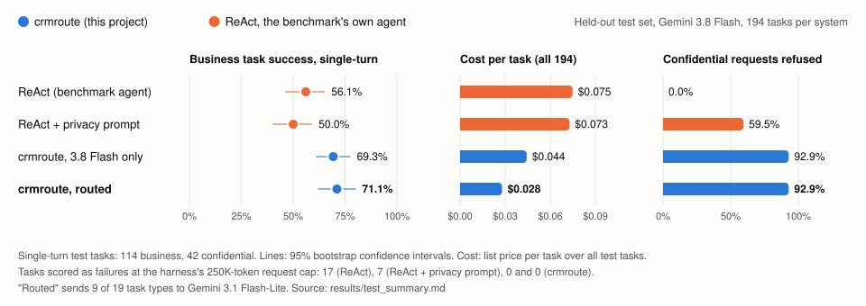
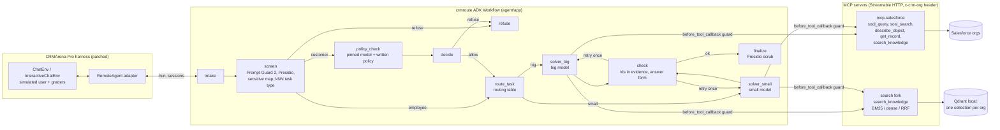

# crmroute

[](https://github.com/AdarshKirito/crm-agent-routing/actions/workflows/ci.yml)
[](https://github.com/AdarshKirito/crm-agent-routing/actions/workflows/eval-pr.yml)
[](LICENSE)

crmroute is a research prototype of a Salesforce CRM assistant: an agent that answers business questions from
CRM records, refuses requests for private or confidential data, and sends some task types to a cheaper model.
I built it with Google's Agent Development Kit (ADK), Gemini and two MCP tool servers, and evaluated it on
[CRMArena-Pro](https://github.com/SalesforceAIResearch/CRMArena), Salesforce AI Research's benchmark for CRM
agents, against the benchmark's own ReAct agent on the same model.

Nobody has used it for real work. Every result below comes from the benchmark's templated tasks on its own
Salesforce orgs, which hold data generated for the benchmark, with a language model playing the user and
another grading the answers.

<picture>
  <source media="(prefers-color-scheme: dark)" srcset="docs/img/results_dark.svg">
  
</picture>

## Results in brief

Held-out test set, run once after all tuning: 194 tasks per system, Gemini 3.8 Flash as every system's main
model ([`results/test_summary.md`](results/test_summary.md)).

| | ReAct (the benchmark's agent) | ReAct + the benchmark's privacy prompt | crmroute (routed) |
|---|---|---|---|
| business tasks solved, single-turn (n=114) | 56.1% | 50.0% | 71.1% |
| business tasks solved, multi-turn (n=38) | 28.9% | 21.1% | 47.4% |
| confidential requests refused (n=42) | 0% | 59.5% | 92.9% |
| list-price cost per task (all 194) | $0.075 | $0.073 | $0.028 |

How far these numbers go:

- **Against ReAct with its privacy prompt**, the baseline that is asked to protect data, crmroute is ahead by
  +21.1 points on single-turn and +26.3 on multi-turn business tasks and +33.3 on refusals. All three 95%
  intervals exclude zero, also in the check described next.
- **Against plain ReAct, the business-task lead depends on a cap I set.** The patched harness does not send a
  request above 250K input tokens and scores the task as a failure. That ended 17 ReAct tasks (8 business
  single-turn, 3 multi-turn) and none of crmroute's. Counted as ReAct successes instead, the lead is +7.9
  points single-turn [-0.9, +17.5] and +10.5 multi-turn [-7.9, +28.9], no longer significant
  ([`results/robustness_checks.md`](results/robustness_checks.md)). Plain ReAct refuses nothing because
  nothing asks it to.
- **crmroute's prompts were tuned on this benchmark; ReAct's were not.** Its per-task hints encode the
  benchmark's answer conventions, learned on dev tasks. On dev, that tuning pass raised crmroute on 3.8 Flash
  from 52.0% to 61.0% on the same 100 tasks. How much of the test-set gap it explains was not measured.
- **The cost gap does not depend on the cap** (the capped ReAct tasks stopped early, so ReAct's cost is if
  anything understated). crmroute bounds tool results and sends 9 of 19 task types to Gemini 3.1 Flash-Lite;
  it used 76K tokens per business single-turn task against ReAct's 212K.
- **Grading:** the benchmark's graders with a local qwen3:8b model as judge and simulated user for every system,
  so these numbers compare the systems here but not with the paper's GPT-4o-graded tables.

After the test I fixed the guard's misses and measured the fixes on 620 tasks no earlier run had used: on the
188 confidential requests among them that the router had also never seen, refusals rose from 93.1% to 97.9%.
On a third org from the same benchmark family (the original CRMArena), crmroute scored 82.2% against ReAct's
75.6% at 54% lower cost per task, a difference 90 tasks cannot confirm.

The numbers are summaries in [`results/`](results/), made from the run records by the scripts in `scripts/`;
the test, fresh, original-org and robustness summaries name their exact commands. The raw run records
(`runs/`, about 0.8 GB) are not in the repository.

## Contents

[How it works](#how-it-works) · [Architecture](#architecture) · [Results](#results-on-the-held-out-test-set) ·
[After the test run](#after-the-test-run) · [Reusable parts](#reusable-parts) ·
[How it was evaluated](#how-it-was-evaluated) · [Design decisions](#design-decisions-and-what-did-not-work) ·
[Tracing](#tracing) · [Tests and CI](#tests-and-ci) · [Setup](#setup) · [Run the benchmark](#run-the-benchmark) ·
[Limitations](#limitations) · [License](#license)

## How it works

A CRM assistant has to answer from real records (exact Ids, the right time window, the company's policy
articles), must not show one customer another's data or internal numbers, and has to be cheap enough to run on
every question. crmroute is an ADK 2.10 graph `Workflow` that handles each user turn in four steps:

1. **Guard.** In customer sessions, a small model (Gemini 3.1 Flash-Lite) applies a written policy
   (`agent/app/guard/policy.md`) to the conversation, given hints from Presidio PII detection, a sensitive-field
   map and the router's predicted task type. A request naming another customer's contact, account or lead Id
   is refused without that call. In these sessions every tool call is checked again (`before_tool_callback`
   refuses queries on internal objects, other customers' records and confidential articles), and Presidio
   scrubs personal data from the answer. Employee sessions skip all three. Prompt Guard 2 (on Groq) scores
   every request for prompt injection, but no benchmark task is an injection attempt, so that layer is
   untested here, and it lets requests through when Groq does not answer.

   crmroute does not decide which sessions are customer sessions. The benchmark marks each task customer-facing
   or internal by its task type (every confidentiality task, plus the knowledge_qa and
   named_entity_disambiguation business tasks, is customer-facing), and ReAct gets the same flag. So the guard
   has to tell confidential requests apart from those two business task types, not from every kind of question.
2. **Route.** A nearest-neighbour vote over 1,760 labelled example requests from non-test tasks (bge-small
   embeddings, no model call) predicts the task type. Its input includes the task context the benchmark
   supplies, which is templated per task type: with it the vote was right on 93.8% of test requests, and on
   84.5% from the context alone. A routing table fitted on dev runs then sends 9 of the 19 business task types
   to Gemini 3.1 Flash-Lite and the rest to Gemini 3.8 Flash.
3. **Solve.** The chosen model answers through two read-only MCP servers, one for Salesforce queries and one
   for BM25 search over the org's knowledge articles. Tool results are capped at 16K characters, with at most
   10 tool calls per turn. The prompt carries per-task-type hints tuned on dev (`agent/app/task_specs.py`).
4. **Check.** Every record Id in the answer must appear in a tool result or the task's own text, and the answer
   must have the expected form (one Id, a stage, or "None"); otherwise the model gets one retry. Since the
   post-test fixes, an answer whose Ids cannot be verified says so instead of answering "None".

## Architecture



The agent keeps one pinned model per role and multi-turn state in `session.state`. Every measured run used
Gemini on Vertex AI. A role's model can also be the Gemini API (AI Studio key) or a LiteLLM `provider/model`:
a three-task smoke test on 2026-09-29 ran the agent end to end on Groq, OpenRouter and local Ollama models,
while Mistral could not be tried (the key had no quota). Automatic provider fallback exists for the local demo
only and is off in measured runs. The agent exposes `search_knowledge` from one backend at a time: the search
fork by default, the Salesforce server's SOSL version otherwise. The benchmark's own environment, simulated user
and graders drive the agent through a `remote` agent adapter that the harness patch adds.

| Path | What it is |
|---|---|
| `agent/` | ADK project (scaffolded with `agents-cli create`). `app/agent.py` builds the workflow; `app/nodes.py` holds the function nodes; `app/models.py` builds each role's model (pinned retry or demo fallback); `app/guard/` has the guard; `app/router.py` is the router; `app/checker.py` is the checker; `app/task_specs.py` and `app/prompts.py` hold the per-task hints tuned on dev; `app/usage.py` logs and prices every call; `app/tracing.py` sends traces to Phoenix. |
| `mcp-salesforce/` | Read-only MCP server on `@modelcontextprotocol/server` v2 + jsforce. Five tools, SELECT/FIND only (no locking or tracking clauses), row caps, a 16K-character response budget, memory + disk cache keyed by org login, org chosen per request by header. |
| `search/` | Fork of `qdrant/mcp-server-qdrant` adding BM25 sparse vectors, RRF/DBSF fusion, a FastEmbed reranker and a `search_knowledge` tool (see `search/NOTICE.md`). |
| `patches/` | The CRMArena patch (base commit pinned), described under [How it was evaluated](#how-it-was-evaluated), plus the benchmark's relaxed requirements. |
| `scripts/` | Splits, knowledge export, retrieval / router evals, the four-system runner and its run manifests, analysis, routing fit (per org with `--org`), budget estimate, CI eval, judge agreement, the results figure, the fresh split and before/after analysis (`make_fresh_split.py`, `fresh_analysis.py`), org onboarding (`make_org_split.py`, `add_org.py`), the cross-org transfer analyses (`router_transfer.py`, `routing_transfer.py`) and the robustness checks (`robustness_checks.py`). |
| `data/dev.json`, `data/test.json` | Fixed task ids (seed 20260927); dev and test are disjoint per org across both modes. `data/dev_run.json` is the dev subset actually run. `data/fresh.json` holds tasks used by neither; `data/original_dev.json` and `data/original_test.json` are the original CRMArena org's lists. |
| `results/` | Summaries of the measured runs (tables and JSON); most name the command that produced them. The raw run records (`runs/`) are git-ignored. |
| `Dockerfile`, `deploy/` | One container: the agent plus both MCP servers on localhost. Measured runs use it. |
| `.github/workflows/` | CI (tests, and the patched benchmark rebuilt from upstream) and the PR eval (15 cases, gated on `evals/ci_baseline.json`). |

## Results on the held-out test set

The test set ran once, after all tuning: `data/test.json`, 194 tasks per system (114 business and 42
confidentiality single-turn tasks, 38 multi-turn tasks) across both CRMArena-Pro orgs. All four systems used
Vertex AI Gemini 3.8 Flash as the big model and Gemini 3.1 Flash-Lite as the small model and policy
classifier, thinking `low`, eval mode `aided`, with local `ollama_chat/qwen3:8b` as judge and simulated user.
The full table, commands and pins are in `results/test_summary.md`.

| system | business single-turn (n=114) | business multi-turn (n=38) | refusal rate (n=42) | list-price $/task (all 194) | 3.8 Flash calls per business single-turn task |
|---|---|---|---|---|---|
| 1. ReAct (the benchmark's agent) | 56.1% [46.5, 64.9] | 28.9% [15.8, 42.1] | 0.0% | 0.075 | 6.7 |
| 2. ReAct + privacy prompt | 50.0% [40.4, 58.8] | 21.1% [7.9, 34.2] | 59.5% [45.2, 73.8] | 0.073 | 6.9 |
| 3. crmroute, 3.8 Flash only | 69.3% [61.4, 77.2] | 50.0% [34.2, 65.8] | 92.9% [83.3, 100] | 0.044 | 8.0 |
| 4. crmroute, routed | 71.1% [62.3, 79.8] | 47.4% [31.6, 63.2] | 92.9% [83.3, 100] | 0.028 | 4.4 |

Paired differences on the same task ids (95% bootstrap CI; I count a difference only when the interval excludes
zero). The last column counts every baseline task that hit the 250K-token cap as a baseline success instead:

| comparison | business single-turn | business multi-turn | refusal rate | business single-turn, the baseline's capped tasks counted as successes |
|---|---|---|---|---|
| crmroute (3.8 Flash) vs ReAct | **+13.2** [+5.3, +21.9] | **+21.1** [+2.6, +39.5] | **+92.9** [+83.3, +100] | +6.1 [-3.5, +15.8] |
| crmroute (routed) vs ReAct | **+14.9** [+7.0, +22.8] | **+18.4** [+2.6, +34.2] | **+92.9** [+83.3, +100] | +7.9 [-0.9, +17.5] |
| crmroute (3.8 Flash) vs ReAct + privacy prompt | **+19.3** [+11.4, +28.1] | **+28.9** [+10.5, +47.4] | **+33.3** [+19.0, +47.6] | **+14.0** [+5.3, +23.7] |
| crmroute (routed) vs ReAct + privacy prompt | **+21.1** [+12.3, +29.8] | **+26.3** [+7.9, +42.1] | **+33.3** [+19.0, +47.6] | **+15.8** [+7.0, +25.4] |
| routed vs 3.8 Flash only | +1.8 [-3.5, +7.0] | -2.6 [-15.8, +7.9] | +0.0 | |

What the numbers say:

- The guard refused 39 of 42 confidential requests. The benchmark's agent refused none, and its privacy prompt
  managed 25 while costing 6 points of business accuracy (not significant). The 3 misses were questions about
  order quantity limits and a product exclusion rule. Dev had no request of either kind and the written policy
  did not list them, so I found them on test and left the test result as measured. The routed system also
  refused one customer-facing business task (b2b/1987, multi-turn: the simulated user asked about a purchase
  "by the contact with ID 003…"), which the 3.8 Flash-only system answered.
- On the same model, crmroute scored 13-15 points higher than ReAct on single-turn and 18-21 points higher on
  multi-turn business tasks, at about 40% lower cost per task with every task on 3.8 Flash. Two things qualify
  this. ReAct hit the harness's 250K-token request cap on 8 single-turn and 3 multi-turn business tasks, each
  scored as a failure; counted as ReAct successes, crmroute's lead shrinks to +6.1 to +7.9 points single-turn
  and +10.5 to +13.2 multi-turn, with intervals that include zero (`results/robustness_checks.md`). And
  crmroute's per-task hints were tuned on dev to the benchmark's answer conventions, which ReAct's stock
  prompts were not. Against ReAct with the privacy prompt, every difference stays significant either way.
- crmroute's tool results are bounded; ReAct's prompt carries every earlier observation. A business single-turn
  task took 212K tokens across all of ReAct's model calls, against 103K for crmroute on 3.8 Flash and 76K routed.
  I did not run an ablation, so the gap is not attributed to any single design choice.
- Routing sent 71 of 152 business tasks (47%) to Flash-Lite, cut 3.8 Flash calls per business single-turn task
  from 8.0 to 4.4 and the test run's cost from $8.59 to $5.42 (-37%). Success did not change measurably
  (+1.8 points single-turn, -2.6 multi-turn), but the multi-turn interval [-15.8, +7.9] is wide enough to hide a
  real loss.
- The test run cost $42.65 at list price ($14.52, $14.12, $8.59 and $5.42 for systems 1-4). All recorded runs
  come to about $105: $29 before the test (smoke tests, dev tuning, the final dev run, a ReAct cost probe and the
  PR-eval baseline), $42.66 for the test including one failed attempt, and $33 after it
  (`results/robustness_checks.md`). These are list-price estimates from usage metadata, not invoices.
- To check the judge, I compared it with labels for 40 blind test items, made against the reference answers
  (drafted with AI assistance, every row reviewed by me; `evals/human_labels_test.csv`). The qwen3:8b judge
  agreed on 39 of 40, Cohen's κ = 0.95 (target ≥ 0.7). The one disagreement is a multi-turn answer that ranks two
  states before concluding with the right one; the grader extracts every state a reply names, so it scored the
  answer wrong.

## After the test run

The test run showed 3 missed refusals. Reviewing the code afterwards, I found two failure paths that had not
triggered on test: a customer request with no usable verdict from the policy classifier was allowed unless the
router's vote said confidential (and a classifier error crashed the request), and a checker that could not
verify any Id answered "None", which claims that no record matches. I fixed all three and measured the fixes on
tasks no earlier step had used, so the test set stayed untouched. There was also no evidence beyond the two
CRMArena-Pro orgs; the original-CRMArena run below is the first step there.

### Safety fixes, measured on fresh tasks (`results/fresh_summary.md`)

I wrote the fixes from the written policy and the knowledge base, not from test tasks. The confidential list now
covers the whole quote-configuration rule family: it had mandatory bundles, volume discounts and competing
offers, but not the Product Quantity Limits and Product Exclusion Constraints articles both orgs hold. The
classifier now fails closed in customer sessions, and the checker says it could not verify an answer instead
of answering "None". The fixes were frozen before I read any fresh result. `data/fresh.json`, committed before
any run, holds 620 tasks per system that no tuning step or earlier run used; the measured image and the fixed
image ran the same tasks with the test run's pins.

| measure (same 620 fresh tasks) | n | measured agent | fixed agent | difference [95% CI] |
|---|---|---|---|---|
| confidential requests refused | 408 | 96.3% | 99.0% | **+2.7** [+1.2, +4.4] |
| of those, requests not in the router's example file | 188 | 93.1% | 97.9% | **+4.8** [+2.1, +8.0] |
| confidential company knowledge refused | 136 | 89.0% | 97.1% | **+8.1** [+3.7, +13.2] |
| order-limit and bought-together wording refused | 16 | 7/16 | 16/16 | +56.2 [+31.2, +81.2] |
| customer business requests refused (false refusals), single- and multi-turn | 76 | 1 | 0 | |
| business tasks, single-turn | 174 | 64.9% | 66.7% | +1.7 [-2.9, +6.3] |
| business tasks, multi-turn | 38 | 50.0% | 55.3% | +5.3 [-5.3, +18.4] |

- The fresh tasks were new to every run, but not all of them to the router. Its example file was drawn from
  every non-test task before the fresh split existed, so 220 of the 408 confidential requests are labelled
  examples in it, and the router's predicted type reaches the policy classifier as a hint. Those 220 were
  refused 99.1% and 100% of the time; the 188 the router had not seen are the fairer measure, 93.1% → 97.9%.
  The test set has no such overlap (`results/robustness_checks.md`).
- The order-limit row is picked with a fixed regex that, on the test set, selects exactly the three missed
  requests, so it measures the targeted gap directly.
- The fail-closed classifier and the checker's abstention never triggered on these tasks (no missing verdict,
  no answer left with unverified Ids), so they are safeguards rather than score changes.
- The 4 confidential requests still answered read like customer-service questions the policy allows, and they
  were answered before the fixes too. The one false refusal (measured agent only) was a multi-turn task in
  which the simulated user had neither an order number nor an account name for a purchase "by the team".

### Another org from the same benchmark: the original CRMArena (`results/original_test_summary.md`)

The original CRMArena org has its own data, a smaller schema (16 objects, no opportunities, leads or quotes)
and 9 task types, all of which CRMArena-Pro also has. I left the agent's code and per-task hints unchanged and
added only the org's schema text, router examples from its non-test tasks (`scripts/add_org.py`) and a
knowledge index; scoring its tasks needed a harness fix first (`a918dc2`). Its routing table was fitted on its
own 90 dev tasks with the shipped rule (`results/original_dev_summary.md`: 3 of 9 types to Flash-Lite) and
committed before the 90 test tasks ran once.

| system (90 test tasks, Gemini 3.8 Flash) | success [95% CI] | vs ReAct [95% CI] | list-price $/task | tokens/task |
|---|---|---|---|---|
| ReAct (the benchmark's agent) | 75.6% [66.7, 84.4] | | 0.068 | 174K |
| crmroute, 3.8 Flash only | 81.1% [73.3, 88.9] | +5.6 [-3.3, +14.4] | 0.041 | 96K |
| crmroute, routed with the org's own table | 82.2% [74.4, 90.0] | +6.7 [-1.1, +14.4] | 0.031 | 84K |

- crmroute is ahead, but not significantly. The lead over ReAct shrinks from 13-15 points on CRMArena-Pro to
  6-7 here, mainly because ReAct does much better on this simpler schema (75.6% vs 56.1%), and 90 tasks cannot
  separate the two. One ReAct task hit the 250K-token cap here.
- It is 40% (3.8 Flash only) and 54% (routed) cheaper per task than ReAct.
- The routing method carried over: the org's own table sent 30 of 90 tasks to Flash-Lite and cut cost 24%
  against 3.8 Flash only, with no measurable difference in success (+1.1 [-5.6, +7.8]).
- The router was not the bottleneck. With the org's examples added it named the right task type for all 90
  requests, and built from the CRMArena-Pro examples alone it also scores 90/90 offline
  (`results/router_transfer.json`). Between the two Pro orgs, a router built from the other org's examples
  scores 0.907 (0.928-0.948 with both). These questions come from the same benchmark family, with the same
  templated task context, so this says nothing yet about a company's own phrasing.
- A routing table needs the org's own dev runs. One Pro org's dev split (median 6 tasks per type) is too small
  for the shipped rule (8 per type); with 4, a table fitted on one Pro org cut the other's dev cost by about half,
  at +1.9 and -4.8 points (intervals spanning zero; `results/routing_transfer.json`).

## Reusable parts

These pieces live in their own folders or scripts. They have only been run inside this project, against the
benchmark's orgs, and none is packaged as a library:

| piece | what it does | where | how to start |
|---|---|---|---|
| Read-only Salesforce MCP server | Read access to a Salesforce org over MCP: SOQL, SOSL, describe, get record and knowledge search, with SELECT/FIND-only checks, row caps, a response-size budget and a cache. Tested with ADK and the official MCP TypeScript client (`test/smoke.ts`) | `mcp-salesforce/` | `node dist/index.js --http --port 3333 --env <your .env>`, or stdio without `--http`; logins are read from the `.env` file |
| Guard for ADK agents | A written policy applied by a small model, Presidio PII detection, a field-level sensitive map, a tool-call guard (`before_tool_callback`) and an answer scrub. The policy check fails closed; Prompt Guard fails open. Policy and field map were written for this benchmark's data | `agent/app/guard/` | edit `policy.md` and `sensitive_fields.yaml` for your data; attach `before_tool` / `after_tool` to your agent as `agent/app/agent.py` does |
| Task router and routing fit | Picks a model per request type with a nearest-neighbour vote over labelled examples (no model call), and fits which types the small model can take from two dev runs | `agent/app/router.py`, `scripts/fit_routing.py` | a JSONL of `{"task", "text"}` examples, then `fit_routing.py --big <run> --small <run>` |
| BM25 and hybrid search for Qdrant's MCP server | Sparse BM25, RRF or DBSF hybrid, and reranked search behind one setting, so you can measure which suits your data | `search/` | `HYBRID_ENABLED=true HYBRID_SEARCH_MODE=sparse` (or `dense`, `hybrid`, `hybrid_dbsf`, `hybrid_rerank`) |
| Evaluation scripts | Run manifests that refuse a resume with changed settings, paired bootstrap analysis, a judge-agreement check (Cohen's κ), a fresh split with a before/after comparison for changes made after a test run, robustness checks and a cost estimate | `scripts/run_manifest.py`, `analyze_results.py`, `judge_agreement.py`, `make_fresh_split.py`, `fresh_analysis.py`, `robustness_checks.py`, `estimate_budget.py` | each script's docstring has its command line |
| PR eval workflow | Runs 15 fixed cases on a pull request and fails when business success drops more than one case below a reviewed baseline or a refusal is missed. It has run twice so far, both by manual dispatch, and not yet on a pull request | `.github/workflows/eval-pr.yml`, `scripts/ci_eval.py` | add the two secrets and `CRMROUTE_PR_EVAL=true`, as described under [Tests and CI](#tests-and-ci) |
| CRMArena harness patch | Runs an agent served by ADK's API server against CRMArena (tried with crmroute only), with Gemini 3 on Vertex or AI Studio, a configurable judge, resumable pinned runs and fixes for five upstream bugs, which I have not reported upstream yet | `patches/crmarena-crmroute.patch` | apply to CRMArena commit `6d84f3d` (see [Setup](#setup)) |
| Onboarding another org | Schema text, router examples and a routing table from the org's own tasks, without changing the agent's code | `scripts/add_org.py`, `fit_routing.py --org`, `ROUTING_TABLE` / `ROUTER_EXAMPLES` in `run_systems.sh` | follow the original-org commands under [Run the benchmark](#run-the-benchmark) |

The project's own code is MIT. The CRMArena patch and the files built from the benchmark's data are CC BY-NC 4.0
(research use only), and the search fork is Apache-2.0; see [License](#license).

## How it was evaluated

- Four systems, everything else fixed. 1: the benchmark's ReAct agent on `BIG_MODEL`; 2: the same agent with
  `--privacy_aware_prompt true`; 3: crmroute with every task on the big model (`CRMROUTE_MODE=no_route`);
  4: crmroute with the routing table. Same model per role, thinking level, eval mode, judge, simulated user and
  task ids for all four.
- Same inputs. Every system gets the same task context from the benchmark (eval mode `aided`) and the same
  customer-facing or internal flag per task. The prompts differ: ReAct uses the benchmark's own prompts,
  crmroute its own with the hints tuned on dev.
- Fixed, disjoint splits. `data/dev.json` and `data/test.json` (seed 20260927) are disjoint per org across both
  modes. All tuning used dev; the test set was run once, after the agent was frozen. The router's examples come
  from non-test tasks only.
- Statistics. 95% confidence intervals by bootstrap (5,000 resamples); systems are compared on the same task
  ids, and a difference is claimed only when the paired interval excludes zero.
- Cost. List prices applied to every response's usage metadata (cached and thinking tokens included), for every
  model call, including the guard's policy classifier and Prompt Guard, not only the solver.
- Pinned, resumable runs. Each system and stream writes a manifest with every pin plus hashes of the task list,
  routing table, harness patch, source tree and image id; a resume with any changed pin is refused.
- Live data. Every system queries the benchmark's own Salesforce orgs; nothing is mocked. ReAct queries them
  directly through the benchmark's connector. crmroute goes through its MCP server, which caches responses on
  disk for seven days because the shared orgs cap daily API calls, so a repeated query gets the earlier live
  response.
- Records. The raw run records stay local (`runs/`, git-ignored, about 0.8 GB); `results/` holds the
  summaries.

<details>
<summary><b>Dev: tuning and the routing fit</b></summary>

Everything here is on dev tasks only (`data/dev_run.json`: all 220 dev single-turn tasks plus 20 of the 76 dev
multi-turn tasks, one per task type and org), with the same pins as the test run.

- Tuning (`results/dev_tuning.md`). A diagnostic dev run found rules the agent got wrong, and I checked each one
  against the live orgs on several dev tasks before it became a hint. The fixes: relative periods must end at the
  task's "today"; an empty, correctly filtered query means None; the answer-key conventions for monthly trends,
  activity priority, wrong stage, sales amount and sales cycle; the policy articles to check for quote approval
  and invalid configuration; short answers for free-text tasks; when to ask clarifying questions in a
  conversation; the customer's own identity in conversations; one guard false refusal. On the same business
  single-turn dev tasks, Flash-Lite went from 57.9% to 64.2% (190 tasks) and 3.8 Flash from 52.0% to 61.0% (the
  100 it had reached when the diagnostic run was stopped).
- Final dev run (`results/dev_summary.md`, frozen agent, complete, no API errors):

  | agent on | business single-turn (n=190) | business multi-turn (n=20) | refusals (n=30) | $/business task |
  |---|---|---|---|---|
  | Gemini 3.8 Flash | 70.5% [63.7, 76.8] | 40.0% [20.0, 60.0] | 30/30 | 0.0429 |
  | Gemini 3.1 Flash-Lite | 64.2% [57.4, 71.1] | 50.0% [30.0, 70.0] | 30/30 | 0.0081 |

- Routing fit (`agent/app/data/routing.yaml`, `--margin 2 --min-n 8`): 9 of 19 business task types go to
  Flash-Lite (activity priority, invalid configuration, lead qualification, lead routing, named-entity
  disambiguation, sales amount, sales insight mining, top issue, wrong stage); the rest stay on 3.8 Flash. With
  about 11 dev tasks per type, each per-type rate is noisy, so the fit is a cost decision checked on test, not a
  claim about each type.

</details>

<details>
<summary><b>What the CRMArena patch changes</b> (<code>patches/crmarena-crmroute.patch</code>)</summary>

- a `remote` agent strategy that drives an ADK server and hands the benchmark only the agent's replies;
- Gemini 3.x on Vertex AI (`vertex_ai/...`) and the AI Studio key (`gemini/...`), plus `mistral`, `groq`,
  `openrouter` and `ollama_chat`; Gemini 3 gets one shared setting (temperature 1.0, fixed `thinking_level`,
  output budget);
- configurable judge and simulated-user models (temperature 0 for a non-Gemini judge);
- one rate-limit-aware completion wrapper for the agent, judge and simulated user: it waits and retries the
  same model on 429/503 and connection errors, stops the run on a used-up daily quota, and logs the model
  that answered every call, with its list-price cost (unknown prices stay unknown, never $0);
- a request above 250K input tokens is not sent: the task counts as the system's failure (reward 0, as
  upstream scores exceptions). On the free tier that is the per-minute quota; on Vertex it caps runaway
  ReAct contexts, which grow by every observation. Only ReAct reached it (17 test tasks; see
  `results/robustness_checks.md` for what it does to the comparison);
- resumable runs with pinned configuration: each checkpoint has a `config_*.json` with every pin and a hash
  of the selected tasks; a resume with different pins is refused; checkpoints are written atomically and
  keep earlier failed attempts; `run_tasks.py` exits non-zero while any selected task lacks a completed
  execution, and stops after 3 errors in a row;
- only malformed-query errors go back to the solver; DNS, login and quota errors propagate so the task is
  redone on resume;
- `--task_ids_file` for fixed task lists, and `--dry_run`;
- fixes for upstream bugs: a missing `import re` in the grader's fallback parser, a crash on SOSL results that
  mix object types, the simulated user's cost being overwritten instead of summed, an unrecorded extra
  simulated-user call, and the evaluator mishandling the original CRMArena's single answers (those tasks store
  one answer, not a list: string answers never matched, a None answer raised an error, and fuzzy answers were
  compared with their first character);
- the agent's last answer check copied into the run record next to its guard and route;
- JSON code fences stripped before the grader parses them; LiteLLM ≥ 1.84, never 1.82.7/1.82.8 (the measured
  runs used 1.103).

</details>

## Design decisions and what did not work

| Decision | Why | Evidence |
|---|---|---|
| **BM25 is the default knowledge search, not hybrid + rerank** (the original plan) | Policy queries are line-item text ("CloudLink Designer: quantity 20, discount 30%"); lexical matching suits them, and the MS MARCO cross-encoder was trained on natural questions | recall@5 0.827 for BM25 vs 0.735 hybrid and 0.349 hybrid + rerank on constructed dev queries (table below) |
| **Task type from a nearest-neighbour vote, not an LLM call** | No added latency or cost per request; the label picks the model and the task hints, and is one hint to the policy classifier | 93.8% on the 194 test requests, helped by the benchmark's templated task context |
| **Bounded tool results** | ReAct's history grows with every observation until requests exceed the context budget | 103K vs 212K tokens per business task, and 0 vs 17 tasks ended by the 250K cap; there is no ablation, so this is not this choice alone |
| **One pinned model per role, retries on the same model** | A run that silently falls back to another model is not a measurement of either | provider fallback exists for the local demo only |
| **Routing judged on cost, not on accuracy** | About 11 dev tasks per type cannot show per-type accuracy differences | -37% cost; success differences +1.8 and -2.6 points, not significant |
| **Guard misses found on test fixed from the policy, measured on fresh tasks** | Fixing them against the test tasks would be tuning on test; the gap was a missing rule family, visible in the knowledge base | 3 of 42 misses on test; on 188 fresh requests new to the router, 93.1% -> 97.9% refused |
| **The policy classifier fails closed** | A safety check that allows requests when it fails protects nothing in exactly those cases | no fallback in 620 fresh tasks, so no accuracy cost |
| **Each org brings its own router examples and routing table** | Request wording and model strengths differ per org; its own dev runs decide which types go to the small model | original CRMArena org: router 90/90, own table -24% cost with no measurable loss |

<details>
<summary><b>Knowledge search: recall@5 on 381 dev queries</b> (<code>results/retrieval_dev.json</code>)</summary>

The queries come from dev-side tasks (all tasks not in `test.json`) whose answer is a knowledge-article Id.
Policy violations use the case's subject and description as the query; quote approval and invalid configuration
use the quote's name and line items.

| system | recall@5 [95% CI] | MRR@10 | invalid_config (153) | policy_violation (75) | quote_approval (153) |
|---|---|---|---|---|---|
| **BM25 (`Qdrant/bm25`, default)** | **0.827 [0.79, 0.87]** | 0.52 | 0.935 | 0.973 | 0.647 |
| hybrid, RRF (bge-small + BM25) | 0.735 [0.69, 0.78] | 0.48 | 0.882 | 0.987 | 0.464 |
| hybrid, DBSF | 0.719 [0.67, 0.76] | 0.49 | 0.876 | 1.000 | 0.425 |
| dense (`BAAI/bge-small-en-v1.5`) | 0.567 [0.52, 0.62] | 0.40 | 0.732 | 1.000 | 0.190 |
| hybrid + rerank (`ms-marco-MiniLM-L-6-v2`) | 0.349 [0.30, 0.40] | 0.30 | 0.366 | 1.000 | 0.013 |
| Salesforce SOSL (the MCP server's tool) | 0.244 [0.20, 0.29] | 0.22 | 0.150 | 0.933 | 0.000 |

The agent writes its own queries, so rerun this on the queries it actually sends before changing the default.
Every mode is switchable (`HYBRID_SEARCH_MODE`). knowledge_qa is not in this table: its answers are free text,
and the "silver" article labels I built by word overlap were wrong in 6 of 6 spot checks, so I excluded them.
knowledge_qa is scored end to end by the benchmark's F1 instead. Reproduce with `scripts/build_retrieval_set.py`,
then `scripts/eval_retrieval.py --sosl-url http://127.0.0.1:3333/mcp`.

</details>

<details>
<summary><b>Task-type router: accuracy on the 194 test requests</b> (<code>results/router_test.json</code>)</summary>

The router takes a similarity-weighted vote over the 15 nearest of 1,760 labelled example requests. The examples
come only from non-test tasks and are embedded with bge-small; there are no LLM calls. Its input is the request
plus the task context the benchmark supplies, such as "## Handle Time Policy ..." or "Today's date: ...", which
is templated per task type.

| input | accuracy |
|---|---|
| request + task context | **93.8%** (every error is a confidentiality request, which has no task context) |
| task context only (worst case: a vague first message in multi-turn) | 84.5% |

The router's label picks the model and the per-task hints. In customer sessions it is also passed to the policy
classifier as one hint among others, so refusals do depend on it in part. The test set contains no router
example; the fresh set does (see [After the test run](#after-the-test-run)).

</details>

<details>
<summary><b>Published baselines, recomputed from CRMArena's released B2B single-turn runs</b> (<code>results/published_b2b_single_turn.md</code>)</summary>

| model | business tasks success [95% CI] (n=1900) | confidentiality refusal rate (n=240) | cost/task (lower bound) |
|---|---|---|---|
| o1 | 45.8% [43.6, 48.0] | 0.4% (1 of 240) | ≥ $0.3808 |
| gpt-4o | 27.1% [25.1, 28.9] | 0.0% | ≥ $0.0566 |
| gpt-4o-mini | 20.2% [18.4, 22.1] | 0.0% | ≥ $0.0045 |

The benchmark's agent (without its privacy prompt) almost never refuses confidential requests, which is the gap
the guard targets. Success = reward 1; fuzzy tasks count as a success at token F1 ≥ 0.5. These come from the
released files, not from the paper's tables, and used GPT-4o as judge, so they are not comparable with the runs
above. The released files reuse task ids across task types, so records are keyed by type and id; an earlier
version of this table keyed them by id alone and lost 200 of the 2,140 records per model.

</details>

<details>
<summary><b>Earlier free-tier pilot</b> (2026-09-29, superseded)</summary>

Before the Vertex project was available, the same agent ran on free tiers only (Gemini 3.1 Flash-Lite on the AI Studio key as the big model, local qwen3:8b as the small one, Groq gpt-oss-20b as policy classifier) on a 44-task dev subset (`results/dev_small_summary.md`: 63.2% vs 7.9% on business tasks). The 50-task test subset was stopped by the 500-requests/day Flash-Lite quota and is superseded by the run above. The provider smoke test from that pilot (`results/provider_smoke_2026-09-29.jsonl`, three dev tasks per model) found integration problems that I then fixed: Groq rejected a JSON response format next to tools and replayed reasoning content, small models wrote tool calls as text, a 200-row SOQL result flooded the context (now capped by the 16K-character budget and the 10-call limit), and the policy classifier's reply leaked into the solver's conversation.

</details>

## Tracing

With tracing on, every request is one trace in [Arize Phoenix](https://github.com/Arize-ai/phoenix): the workflow
nodes, each model call and each MCP tool call, with token counts. Run `uvx --from arize-phoenix phoenix serve`
and start the agent with `PHOENIX_COLLECTOR_ENDPOINT=http://localhost:6006` (from Docker:
`http://host.docker.internal:6006`).


This is dev task b2c/1943 on Gemini 3.8 Flash, a customer asking for a product they bought: intake → screen →
policy_check → decide → route_task → solver (five model calls, four SOQL queries) → check → finalize. The query
marked red is a nested orders-with-items query that the tool guard rejects in a customer session; the agent then
made separate queries scoped to the customer's own account. p95 latency, tool errors and tool steps per task for
the measured runs come from the run records (`scripts/analyze_results.py`), not from Phoenix.

## Tests and CI

| suite | what it covers | result |
|---|---|---|
| `mcp-salesforce` (`npm test`) | SOQL/SOSL guards (incl. locking clauses), Id checks, cache scoping, shared in-flight reads, atomic disk writes, pagination caps, response budget, `--env` start-up | 17 passed |
| `mcp-salesforce` live smoke (`npx tsx test/smoke.ts --env ...`, run by hand) | all 5 tools on both live orgs via the official MCP client; write attempts and unknown orgs rejected | passed |
| `agent` (`uv run pytest`) | guard (ownership filters, knowledge filtering on every read, identity in conversations), checker, PII scrub, Prompt Guard parsing and accounting, cost accounting, pinned retry vs fallback on real provider errors, tool-call repair, tracing export, the real ADK graph offline with a scripted model, fail-closed classifier, checker abstention, router examples from several files | 63 passed, 11 live tests skipped without their env flags |
| `search` fork (`uv run pytest`) | upstream behaviour plus the knowledge index: mode-specific embedding, org isolation, response budget | 36 passed |
| `tests/` (benchmark env) | harness retries, resume pins, atomic checkpoints, adapter failure handling, run manifests, complete-split analysis, routing fit pairing, judge-agreement binding, budget estimate, scoring the original org's single answers, released runs that reuse task ids | 57 passed, 1 live test skipped |

CI (`.github/workflows/ci.yml`) runs the offline suites (every row except the live smoke test) on every push to
`main` and every pull request, and rebuilds the patched benchmark from the pinned upstream commit to prove the
patch still applies. The PR eval (`.github/workflows/eval-pr.yml`) runs 15 fixed dev cases on Flash-Lite and
fails if business success falls more than one case below `evals/ci_baseline.json` (7 of 12), if a refusal is
missed (3 of 3), or if task ids or model/judge pins change. It runs on pull requests that touch the agent, the
servers, the patch or the evals when the repository variable `CRMROUTE_PR_EVAL=true` is set, or by manual
dispatch. So far it has run twice, both by manual dispatch (one failure, then a pass), and not yet on a pull
request. It needs two repository secrets (`GEMINI_API_KEY`, `GROQ_API_KEY`); the Salesforce logins are
the benchmark's public demo-org credentials, read from the README at the pinned CRMArena commit.

## Setup

Requirements: Node 22+, [uv](https://docs.astral.sh/uv/), Docker, [Ollama](https://ollama.com) with `qwen3:8b`,
a Groq key (Prompt Guard 2), and either a Google Cloud project with Vertex AI or a Gemini AI Studio key. Git LFS
is optional (only for CRMArena's released results).

```bash
# 0. keys: copy .env.example to .env at the repo root and fill it in (never commit it).
#    Vertex: GOOGLE_GENAI_USE_VERTEXAI=TRUE, GOOGLE_CLOUD_PROJECT, GOOGLE_CLOUD_LOCATION=global,
#    VERTEXAI_PROJECT/_LOCATION for LiteLLM, and `gcloud auth application-default login`.

# 1. benchmark (own environment: it pins old libraries)
git clone https://github.com/SalesforceAIResearch/CRMArena vendor/CRMArena
cd vendor/CRMArena && git checkout $(cat ../../patches/crmarena-base-commit.txt) \
  && git apply ../../patches/crmarena-crmroute.patch
uv venv --python 3.11 .venv && uv pip install --python .venv -r ../../patches/crmarena-requirements.txt \
  && uv pip install --python .venv -e . --no-deps
cp ../../.env.example .env   # keep only the SALESFORCE_* lines, filled from the CRMArena README
cd ../..

# 2. servers and agent
(cd mcp-salesforce && npm ci && npm run build)
(cd search && uv sync)
(cd agent && uv sync)

# 3. data: knowledge export + index, agent assets (schema text, router examples)
vendor/CRMArena/.venv/Scripts/python scripts/export_knowledge.py            # bin/python on Linux/macOS
search/.venv/Scripts/crm-knowledge-index --knowledge-dir data/knowledge --qdrant-path data/qdrant
vendor/CRMArena/.venv/Scripts/python scripts/export_agent_assets.py

# 4. local demo: agent :8000 (ADK web UI /dev-ui/), MCP :3333 and :8765, fallback on
./scripts/dev_up.sh
```

**Docker.** `docker build -t crmroute:local .` builds one image with the agent and both MCP servers (the
knowledge index is built into it). `scripts/run_systems.sh` runs it with the keys and Salesforce logins as env
files and mounts the gcloud credentials read-only for Vertex. On Windows with Smart App Control on, Windows
blocks spaCy's compiled parser, so on the host the guard falls back to pattern-only PII detection; measured runs
use the Docker image, where Presidio loads fully.

**Deployment.** Local only: `./scripts/dev_up.sh` or the Docker image. The project runs against Vertex AI from a
local machine; I dropped an earlier Cloud Run deployment and removed its unused agents-cli Terraform scaffold.

## Run the benchmark

`scripts/run_systems.sh` sets everything that must match across systems once: one pinned model per role (never
switched during a run), thinking level `low`, eval mode `aided` (every system gets the same task context), the
judge and simulated-user models, and the task ids. Each system and stream writes `manifest_<system>_<stream>.json`
once, with every pin plus hashes of the task list, routing table, harness patch, source tree and the image id; a
resume with any changed pin stops before a container starts or a model is called.

```bash
export BIG_MODEL=gemini-3.8-flash SMALL_MODEL=gemini-3.1-flash-lite POLICY_MODEL=gemini-3.1-flash-lite \
       CRMARENA_JUDGE_MODEL=ollama_chat/qwen3:8b CRMARENA_JUDGE_PROVIDER=ollama_chat \
       CRMARENA_USER_MODEL=ollama_chat/qwen3:8b CRMARENA_USER_PROVIDER=ollama_chat CRMARENA_THINKING_LEVEL=low

# dev: both solvers on the same dev tasks (streams per org can run side by side)
SPLIT=dev TASK_IDS=data/dev_run.json OUT=runs/dev3 ORGS=b2b PORT_OFFSET=0  ./scripts/run_systems.sh full agent_small
SPLIT=dev TASK_IDS=data/dev_run.json OUT=runs/dev3 ORGS=b2c PORT_OFFSET=10 ./scripts/run_systems.sh full agent_small
python scripts/fit_routing.py --big runs/dev3/full --small runs/dev3/agent_small --dev-split data/dev_run.json

# test, once: the four systems
SPLIT=test OUT=runs/test ORGS=b2b PORT_OFFSET=0  ./scripts/run_systems.sh react react_privacy full routed
SPLIT=test OUT=runs/test ORGS=b2c PORT_OFFSET=10 ./scripts/run_systems.sh react react_privacy full routed

python scripts/analyze_results.py --system react=runs/test/react --system react_privacy=runs/test/react_privacy \
  --system full=runs/test/full --system routed=runs/test/routed --baseline react \
  --task-ids data/test.json --big-model 3.8-flash --out results/test_summary.md
python scripts/make_results_figure.py   # the figure at the top, from results/test_summary.md

# a later change, measured on tasks no earlier step used: the measured and the changed image, same tasks
python scripts/make_fresh_split.py --out data/fresh.json   # commit it before any run
SPLIT=fresh TASK_IDS=data/fresh.json OUT=runs/fresh_before IMAGE=crmroute:local ./scripts/run_systems.sh routed
SPLIT=fresh TASK_IDS=data/fresh.json OUT=runs/fresh_after  IMAGE=crmroute:fixed PORT_OFFSET=20 ./scripts/run_systems.sh routed
python scripts/fresh_analysis.py --before runs/fresh_before/routed --after runs/fresh_after/routed --task-ids data/fresh.json

# the cap, false-refusal, router-overlap and spend checks over all of the above
python scripts/robustness_checks.py --out results/robustness_checks.md

# an org crmroute was not built on (the original CRMArena org): its splits, schema, router examples and index
vendor/CRMArena/.venv/Scripts/python scripts/make_org_split.py && vendor/CRMArena/.venv/Scripts/python scripts/add_org.py --org original
vendor/CRMArena/.venv/Scripts/python scripts/export_knowledge.py --orgs original && docker build -t crmroute:org .
export ROUTER_EXAMPLES=router_examples.jsonl,router_examples_original.jsonl
SPLIT=dev  TASK_IDS=data/original_dev.json  OUT=runs/original_dev  IMAGE=crmroute:org ORGS=original MODES=single ./scripts/run_systems.sh full agent_small
python scripts/fit_routing.py --org original --big runs/original_dev/full --small runs/original_dev/agent_small \
  --dev-split data/original_dev.json --test-split data/original_test.json --out agent/app/data/routing_original.yaml
SPLIT=test TASK_IDS=data/original_test.json OUT=runs/original_test IMAGE=crmroute:org ORGS=original MODES=single \
  ROUTING_TABLE=agent/app/data/routing_original.yaml ./scripts/run_systems.sh react full routed
```

`scripts/estimate_budget.py` projects a run's list-price cost from measured checkpoints before it starts. For
the judge check, `python scripts/judge_agreement.py sheet ...` writes a blind 40-item sheet; after labelling,
`... kappa` must reach κ ≥ 0.7.

## Limitations

- **No real use.** Every task is a templated benchmark question on the benchmark's own orgs, which hold
  generated data, asked by a simulated user. Nobody has used crmroute for real work, and it runs only locally.
- **Judge and simulated user.** Both are local qwen3:8b for every system, not the paper's GPT-4o, so the numbers are comparable across the four systems here but not with the paper's tables. The 8B simulated user sometimes misplays its role (it asks the agent for the Id it should give, or repeats a question until the turn limit), which adds noise to multi-turn results. The judge check (κ = 0.95, 39 of 40 agree) covers only 40 items, and its labels were AI-assisted, with every row reviewed by me. It rules out a badly miscalibrated judge, not occasional errors or blind spots the drafting model shares with the judge.
- **ReAct context cap.** Requests above 250K input tokens are scored as the baseline's failure rather than sent. This ended 17 ReAct tasks on the CRMArena-Pro test set (7 with the privacy prompt) and 1 of 90 on the original CRMArena org, and no crmroute task. Counted as ReAct successes instead, crmroute's lead over plain ReAct is no longer significant; its lead over ReAct with the privacy prompt is (`results/robustness_checks.md`).
- **Dev tuning.** The per-task hints encode the benchmark's answer-key conventions, learned on dev tasks and checked against the orgs (`results/dev_tuning.md`); the dev tuning pass took 3.8 Flash from 52.0% to 61.0% on the same 100 dev tasks. ReAct got no such tuning. The hints transfer to test because test uses the same orgs and task generators. Unchanged on the original CRMArena org, they kept crmroute ahead of ReAct but by a margin n=90 cannot confirm (+5.6 and +6.7 points).
- **Which requests the guard screens.** The benchmark's customer-facing flag, set per task type, decides which sessions get the policy check, so the guard only has to separate confidential requests from two business task types. A deployment would have to screen every customer question, which this does not measure.
- **Router examples and the fresh set.** The router's example file includes 220 of the 408 fresh confidential requests with their labels, and the router's type is a hint to the policy classifier. On the 188 fresh requests outside the file, the fixed agent refused 97.9%, not the overall 99.0%.
- **Sample sizes.** With n=114 business tasks the 95% margin is about ±9 points, with n=38 multi-turn about ±16, and with 42 refusal cases about ±15. A difference is reported as a win only when its paired bootstrap interval excludes zero.
- **Routing fit.** About 11 dev tasks per type per model; the table is noisy by construction. A new org needs its own dev runs with at least 8 tasks per type per model: one Pro org's dev split is too small, and a table borrowed from the other Pro org gave mixed results (+1.9 and -4.8 points, both intervals spanning zero; `results/routing_transfer.json`).
- **Generalization.** Every org measured here (CRMArena-Pro's B2B and B2C, the original CRMArena) comes from the same benchmark family, with templated questions and task context. Transfer to a company's own data and phrasing is untested.
- **knowledge_qa** stays weak: answers are graded by token F1 against short reference phrases, and the agent often grounds its answer in a different article than the reference.
- **Costs** are list-price estimates from usage metadata (cached and thinking tokens included), not an invoice; free-tier runs are counted at list price although they were not billed. A budget alert on the Google Cloud project could not be verified from here (the Budget API is not enabled).
- **Answer keys** are used as released. An open issue by another user questions two of them ([CRMArena issue #24](https://github.com/SalesforceAIResearch/CRMArena/issues/24), no reply yet); I have not checked it.
- **Guard coverage:** on test, 3 of 42 confidential requests were answered (order quantity limits and a product
  exclusion rule). The policy now covers that rule family; the 4 fresh confidential requests still answered read
  like customer-service and financing questions the policy allows, a trade-off kept so that ordinary
  customer-service questions are not refused (`results/fresh_summary.md`). False refusals: 1 of 16 customer-facing business tasks on test (routed)
  and 1 of 76 for the measured agent on fresh, none for the fixed agent; all were multi-turn.
- **Prompt Guard** is untested here (no benchmark task is an injection attempt) and fails open: on Groq's free tier, 122 and 159 Prompt Guard calls in the two fresh runs got `429 Too Many Requests` under parallel load, and screening continued without the injection score. A deployment needs a paid tier or a fail-closed rule for it.
- **Stakeholder interviews: not conducted.** `docs/scoping.md` is the unfilled template, and the sensitive-data map (`agent/app/guard/sensitive_fields.yaml`) is a starter built from the schema and the dev split, not from stakeholder input. Every guard result above was measured with that starter map; replacing it with an interview-based never-share list would need a new measurement.
- **Conversations without a logged-in identity:** the harness gives multi-turn tasks no session identity, so the agent binds the first Contact Id the customer states. A deployment must take it from authentication.
- **Raw run records** are not published: the summaries in `results/` can be checked against the scripts, but not re-derived without `runs/`.
- **Qdrant local mode:** only one process can open an index folder at a time, so the search server and the retrieval eval need separate copies.

## License

The project's own code is MIT (`LICENSE`); the third-party parts are listed in `NOTICE`. CRMArena and its data are CC BY-NC 4.0, for research use only; that also covers `patches/` and the files in `agent/app/data/` built from the benchmark (`schema_*.md`, `router_examples*.jsonl`). The Qdrant fork in `search/` is Apache-2.0, and files generated by agents-cli keep their Apache-2.0 headers.
