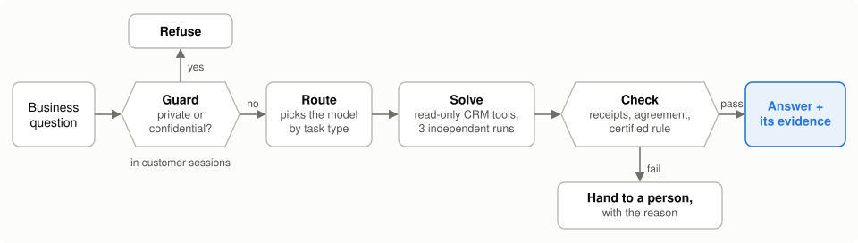
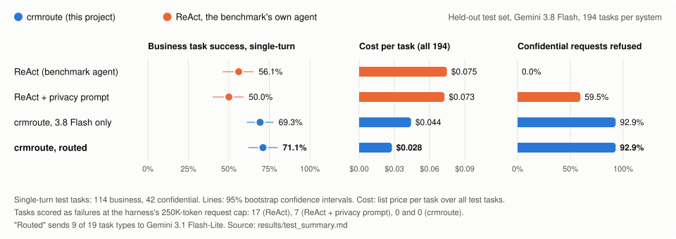

# crmroute

**A CRM assistant that answers questions from Salesforce data, and only gives an answer when it can show its work.**

[](https://github.com/AdarshKirito/crm-agent-routing/actions/workflows/ci.yml)
[](https://github.com/AdarshKirito/crm-agent-routing/actions/workflows/eval-pr.yml)
[](LICENSE)

crmroute answers business questions from a Salesforce CRM, such as "which agent closed the most cases last
quarter?". It refuses requests for private or confidential data and sends easy questions to a cheaper model. When
it cannot back an answer up, it hands the question to a person and says why. I built it with Google's Agent
Development Kit (ADK), Gemini and two MCP (Model Context Protocol) tool servers, and tested it on Salesforce AI
Research's [CRMArena](https://github.com/SalesforceAIResearch/CRMArena) benchmarks.

> **Status:** a finished research prototype. Nobody has used it for real work. Every result below comes from the
> benchmark's templated questions on its own Salesforce orgs, which hold generated data, with a local language
> model playing the user in conversations and grading the answers.

## Why I built it

An AI agent that answers questions from business data is sometimes wrong, and it sounds just as sure when it is.
Benchmarks report an average score, like "71% correct". That tells you nothing about the answer in front of you:
should you act on it or check it first?

So crmroute gives **checkable answers**:

- **Every answer comes with a receipt**: the exact queries it rests on and what they returned. Anyone can re-run
  them against the database.
- **Code, not the model, checks the answer against its receipt**, and three independent runs must agree.
- **A release rule decides what to give out.** Its error rate is measured and certified (at most 10% wrong, with
  90% confidence) on one set of questions. Only then is it used, once, on questions it has never seen.
- **Everything else goes to a person**, with the reason.

<picture>
  <source media="(prefers-color-scheme: dark)" srcset="docs/img/flow_dark.svg">
  
</picture>

## Results in brief

<details>
<summary>Terms used below</summary>

- **ReAct:** the benchmark's own agent, run on the same main model as crmroute.
- **Single-turn / multi-turn:** a task asked in one message, or a conversation with a simulated user.
- **Org:** a Salesforce company database. CRMArena-Pro has two (B2B and B2C); the original CRMArena has one, with its
  own data.
- **Held-out test set:** tasks kept aside and run once, after all tuning was done.
- **95% interval / upper bound:** the range the true value plausibly lies in, given the sample size. For an error
  rate, the upper bound is the highest rate the results still allow.
- **Pre-registered:** the plan, rules and targets were committed to git before any test question ran.

</details>

### 1. Against the benchmark's own agent

The held-out test set ran once, after all tuning: 194 tasks per system, with Gemini 3.8 Flash as every system's
main model ([`results/test_summary.md`](results/test_summary.md)). Here crmroute answers every question it does
not refuse; part 2 adds the release rule.

<picture>
  <source media="(prefers-color-scheme: dark)" srcset="docs/img/results_dark.svg">
  
</picture>

| | ReAct (the benchmark's agent) | ReAct + its privacy prompt | crmroute (routed) |
|---|---|---|---|
| business tasks solved, single-turn (n=114) | 56.1% | 50.0% | **71.1%** |
| business tasks solved, multi-turn (n=38) | 28.9% | 21.1% | **47.4%** |
| confidential requests refused (n=42) | 0% | 59.5% | **92.9%** |
| list-price cost per task (all 194) | $0.075 | $0.073 | **$0.028** |

How far these numbers go:

- **Against ReAct with its privacy prompt**, the baseline that is also asked to protect data, every lead holds up.
  All three 95% intervals exclude zero, also in the token-cap check described next.
- **Against plain ReAct, the business-task lead depends on a token cap** in the test harness. That cap stopped 11
  of ReAct's business tasks (8 single-turn, 3 multi-turn) and none of crmroute's. Counted as ReAct successes
  instead, the leads fall to +7.9 points single-turn [-0.9, +17.5] and +10.5 multi-turn [-7.9, +28.9], and neither
  is significant.
- **crmroute's prompts were tuned on the benchmark's development tasks; ReAct's were not.** Removing the tuned hints
  cost 5.3 points single-turn, a drop the sample cannot confirm
  ([hints ablation](docs/results.md#hints-ablation-resultsablation_hintsmd)).
- **The cost gap does not depend on the cap.** crmroute keeps tool results short and sends 9 of 19 task types to
  the cheaper Gemini 3.1 Flash-Lite: 76K tokens per business single-turn task against ReAct's 212K.

### 2. Checkable answers, three pre-registered rounds

For each round I committed the splits, the candidate rules and the targets to git before any test question ran.
The rule was certified on a calibration set, then applied once to a test set of unused tasks.

| Round | What it added | Org | Test questions | Answered | Wrong among answered | 95% upper bound |
|---|---|---|---|---|---|---|
| [1](docs/results.md#checkable-answers-resultscheckable_answersmd) | receipts, three runs, a certified rule | CRMArena-Pro | 304 | 123 (40.5%) | 9 (7.3%) | 12.4% |
| [2](docs/results.md#round-2-a-competence-map-resultscheckable2_answersmd) | withholds task types that went wrong before | CRMArena-Pro | 431 | 194 (45.0%) | 9 (4.6%) | 8.0% |
| [3](docs/results.md#round-3-a-replication-on-another-org-resultscheckable3_answersmd) | the same method on an org it was not built on | original CRMArena | 333 | 144 (43.2%) | 7 (4.9%) | 8.9% |

- **The 10% bound held in rounds 2 and 3.** Round 1's wrong rate was 7.3%, but its upper bound of 12.4% could not
  rule out more than 10%.
- **For comparison, one run that answers everything is right 71% to 79% of the time.** The released answers were
  right 93% to 95% of the time.
- **The price is coverage:** 55% to 60% of the questions go to a person. Rounds 2 and 3 missed their 50% coverage
  target.
- **"Wrong" means wrong against the benchmark's answer key.** A review of round 3's doubtful answers found answer
  keys that follow rules their own task text does not state. I reported it upstream as
  [CRMArena #31](https://github.com/SalesforceAIResearch/CRMArena/issues/31).

Also measured, with details in [`docs/results.md`](docs/results.md):

- **Safety fixes on fresh tasks:** after the test, the guard's fixes raised refusals from 93.1% to 97.9% on 188
  confidential requests no earlier step had seen.
- **Another org:** on the original CRMArena org, crmroute solved 82.2% against ReAct's 75.6% at 54% lower cost.
  With 90 tasks, the difference is not significant.

Every measured number comes from a summary in [`results/`](results/), and most summaries name the command that
made them. The raw run records are published as
[release assets](https://github.com/AdarshKirito/crm-agent-routing/releases), so the summaries made from them can
be rebuilt without rerunning anything.

## Try it in one minute

The checkable-answers method is packaged as [`checkable/`](checkable/), a small Python library with no
dependencies. Its demo needs no accounts, keys or Salesforce:

```bash
git clone https://github.com/AdarshKirito/crm-agent-routing.git
cd crm-agent-routing
python checkable/examples/winter_demo.py      # Python 3.10 or newer
```

The demo builds a small table of support cases and asks "which state had the most cases in winter of 2023?". That
question has three fair readings, and a stand-in agent answers with one of them. Here is part of the real output:

```text
question: Which state had the most cases in winter of 2023?
answer:   'TX'  ->  fail
  [asked] season_months = meteorological; season_year = december_of_y: 2023-12-01 to 2024-03-01 -> 'CA'
  [asked] season_months = meteorological; season_year = december_before_y: 2022-12-01 to 2023-03-01 -> 'TX'
  [asked] season_months = quarter_aligned: 2023-01-01 to 2023-04-01 -> 'CA'
```

Two readings give "CA" and one gives "TX", so the answer depends on the reading and is held back. The demo then
learns from two answered questions which reading this organisation uses, and shows why "TX" is the wrong answer.
Last, it re-runs the agent's saved query and shows the evidence stop matching once the data changes.

To run the full agent against the benchmark, see [`docs/reproduce.md`](docs/reproduce.md). You need Docker, Node
22+, [uv](https://docs.astral.sh/uv/), [Ollama](https://ollama.com), a Groq key, and a Gemini API key or a Vertex
AI project.

## How it works

Each question goes through four steps, built as an ADK graph workflow:

1. **Guard.** In customer sessions, a small model applies a written privacy policy, helped by PII detection
   (Presidio) and a map of sensitive fields. Every tool call is checked again, and personal data is scrubbed from
   the answer.
2. **Route.** A nearest-neighbour vote over 1,760 labelled example requests predicts the task type, with no model
   call; it was right on 93.8% of the test requests. A routing table fitted on development runs then sends 9 of 19
   task types to the cheaper model.
3. **Solve.** The chosen model answers through two read-only MCP servers: one for Salesforce queries, one for
   keyword search over the org's knowledge articles. Tool results are capped, so the context stays small.
4. **Check.** Every record Id in the answer must appear in a tool result, and the answer must have the expected
   form. Otherwise the model gets one retry.

Checkable answers wrap this with three runs, the receipt check and the certified release rule
([method and pre-registration](docs/checkable_answers.md)). The full diagram and a map of every folder are in
[`docs/architecture.md`](docs/architecture.md).

## What's in this repository

| Folder | What it is | Usable on its own? |
|---|---|---|
| [`agent/`](agent/) | The ADK agent: guard, router, solver, checker and receipts | The guard and router, with your own policy and examples |
| [`mcp-salesforce/`](mcp-salesforce/) | A read-only MCP server for Salesforce (TypeScript): SOQL and SOSL queries, object schemas, record lookup and knowledge search | Yes |
| [`search/`](search/) | A fork of Qdrant's MCP server with BM25 and hybrid search | Yes, and proposed upstream |
| [`checkable/`](checkable/) | Checkable answers for any agent that queries a database | Yes, with no dependencies |
| [`patches/`](patches/) | A patch that runs ADK agents on CRMArena, with fixes for five upstream bugs | Yes |
| [`scripts/`](scripts/) | Runs, analysis, statistics and live re-checks | The evaluation scripts |
| [`data/`](data/) | The fixed task splits of every experiment, and round 3's date-reading catalog and learned conventions | |
| [`results/`](results/) | Every measured result; most name the command that produced them | |
| [`tests/`](tests/), [`evals/`](evals/) | Tests for the harness and scripts; the pull-request eval's cases and the judge-check labels | |
| [`Dockerfile`](Dockerfile), [`deploy/`](deploy/) | One container with the agent and both servers, used for crmroute's measured runs | |
| [`docs/`](docs/) | Detailed results, method, pre-registrations and reproduction steps | |

## How I evaluated it

- **Fixed splits.** I tuned only on development tasks, and the test set ran once, after the agent was frozen. One
  later ablation reran it without the tuned hints, to measure what they add.
- **Same conditions for every system:** the same main model, inputs, judge and simulated user. The judge and
  simulated user were a local qwen3:8b. The judge agreed with my labels on 39 of 40 test items (Cohen's κ = 0.95);
  the labels were drafted with AI help and every row was reviewed by me.
- **Statistics:** 95% bootstrap intervals, and a difference counts only when its paired interval excludes zero.
- **Pre-registration:** each checkable-answers round's rules, splits and targets were committed before any test
  question ran, and every failed check is reported.
- **Pinned runs:** every run writes a manifest of its settings, and a resume with any changed setting is refused.
- **Costs** are list prices applied to every model call, including the guard's.

The full method is in [`docs/evaluation.md`](docs/evaluation.md), and every command is in
[`docs/reproduce.md`](docs/reproduce.md).

## What did not work

- **Hybrid search with reranking**, my original plan, lost to plain BM25 keyword search. On constructed
  development queries, recall@5 was 0.349, against 0.735 for hybrid search alone and 0.827 for BM25.
- **Round 3's convention check failed its own go/no-go tests.** It re-runs a query under each reading of a date
  phrase. On rounds 1 and 2's records it held back 30% of right answers. A narrower version, chosen after
  that, helped on fresh questions for only three task types: 3 of 4 wrong answers caught there, at a cost of 5.6%
  of right ones, with small counts.
- **Coverage stayed below half.** Rounds 2 and 3 missed their 50% coverage target, and round 1's error bound missed
  10%.
- **The blinded audit of the answer key was not done**, because no reader with the domain knowledge was available.
  A non-blind review is reported in its place.
- **Against plain ReAct, the business-task lead is not significant** once the tasks stopped by the harness's token
  cap count as ReAct successes.

More design decisions, with their evidence, are in
[`docs/results.md`](docs/results.md#design-decisions-and-what-did-not-work).

## Limitations

The most important; the full list is in [`docs/limitations.md`](docs/limitations.md).

- **No real use.** Every question is a templated benchmark task on generated data, not a real person's.
- **One benchmark family.** Every org here comes from CRMArena. Transfer to a company's own data and wording is
  untested.
- **Grading** is by a local 8B model, not the paper's GPT-4o, so these numbers compare the systems here but not with
  the paper's tables.
- **Small samples:** about ±9 points at 114 tasks and ±16 at 38.
- **The certificate holds against the benchmark's answer key**, and only for questions like the calibration ones.
- **Prompt-injection defence is untested**: no benchmark task is an injection attempt.
- **Stakeholder interviews were not conducted.** The sensitive-data map is a starter built from the schema and the
  development tasks, not from stakeholder input.

## Project status

Complete: all the planned experiments ran between September and November 2026. The dependencies were last updated
for security fixes in November 2026. The bugs and data issues I found in other projects are open upstream:

- **CRMArena:** [#26](https://github.com/SalesforceAIResearch/CRMArena/issues/26)–[#29](https://github.com/SalesforceAIResearch/CRMArena/issues/29)
  (harness bugs, fixed in this repo's patch), [#30](https://github.com/SalesforceAIResearch/CRMArena/issues/30)
  (released results) and [#31](https://github.com/SalesforceAIResearch/CRMArena/issues/31) (answer-key rules).
- **qdrant/mcp-server-qdrant:** [#202](https://github.com/qdrant/mcp-server-qdrant/issues/202) (BM25 and hybrid
  search modes).

Built by [Adarsh Varanasi](https://github.com/AdarshKirito). Questions and bug reports are welcome as
[GitHub issues](https://github.com/AdarshKirito/crm-agent-routing/issues).

## Documentation

| Page | What's in it |
|---|---|
| [`docs/results.md`](docs/results.md) | Every result with its interval and caveats, design decisions, and what did not work |
| [`docs/architecture.md`](docs/architecture.md) | The workflow diagram, every folder, and the reusable parts |
| [`docs/evaluation.md`](docs/evaluation.md) | Splits, statistics, cost accounting, the harness patch, tests, CI and tracing |
| [`docs/reproduce.md`](docs/reproduce.md) | Setup, and the commands behind every result |
| [`docs/limitations.md`](docs/limitations.md) | Everything these results do not show |
| [`docs/checkable_answers.md`](docs/checkable_answers.md) | Checkable answers: method and pre-registration, rounds 1 and 2 |
| [`docs/checkable3_plan.md`](docs/checkable3_plan.md) | Round 3's pre-registration ([development log](docs/checkable3_devlog.md)) |

## License

The project's own code is MIT ([`LICENSE`](LICENSE)); the third-party parts are listed in [`NOTICE`](NOTICE). CRMArena and its data are CC BY-NC 4.0, for research use only; that also covers `patches/` and the files in `agent/app/data/` built from the benchmark (`schema_*.md`, `router_examples*.jsonl`). The Qdrant fork in `search/` is Apache-2.0, and files generated by agents-cli keep their Apache-2.0 headers.
