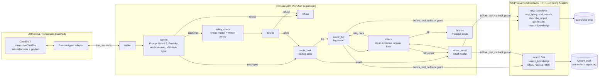

# Architecture

How crmroute handles a request, what each folder holds, and which parts can be reused on their own. The [README](../README.md) has the short version.

## How it works

A CRM assistant has to answer from real records (exact Ids, the right time window, the company's policy
articles), must not show one customer another's data or internal numbers, and has to be cheap enough to run on
every question. crmroute is an ADK 2.10 graph `Workflow` that handles each user turn in four steps:

1. **Guard.** In customer sessions, a small model (Gemini 3.1 Flash-Lite) applies a written policy
   (`agent/app/guard/policy.md`) to the conversation, given hints from Presidio PII detection, a sensitive-field
   map and the router's predicted task type. A request naming another customer's contact, account or lead Id
   is refused without that call. In these sessions every tool call is checked again (`before_tool_callback`
   refuses queries on internal objects, other customers' records and confidential articles), and Presidio
   scrubs personal data from the answer. Employee sessions skip all three. Prompt Guard 2 (on Groq) scores
   every request for prompt injection, but no benchmark task is an injection attempt, so that layer is
   untested here, and it lets requests through when Groq does not answer.

   crmroute does not decide which sessions are customer sessions. The benchmark marks each task customer-facing
   or internal by its task type (every confidentiality task, plus the knowledge_qa and
   named_entity_disambiguation business tasks, is customer-facing), and ReAct gets the same flag. So the guard
   has to tell confidential requests apart from those two business task types, not from every kind of question.
2. **Route.** A nearest-neighbour vote over 1,760 labelled example requests from non-test tasks (bge-small
   embeddings, no model call) predicts the task type. Its input includes the task context the benchmark
   supplies, which is templated per task type: with it the vote was right on 93.8% of test requests, and on
   84.5% from the context alone. A routing table fitted on dev runs then sends 9 of the 19 business task types
   to Gemini 3.1 Flash-Lite and the rest to Gemini 3.8 Flash.
3. **Solve.** The chosen model answers through two read-only MCP servers, one for Salesforce queries and one
   for BM25 search over the org's knowledge articles. Tool results are capped at 16K characters, with at most
   10 tool calls per turn. The prompt carries per-task-type hints tuned on dev (`agent/app/task_specs.py`).
4. **Check.** Every record Id in the answer must appear in a tool result or the task's own text, and the answer
   must have the expected form (one Id, a stage, or "None"); otherwise the model gets one retry. Since the
   post-test fixes, an answer whose Ids cannot be verified says so instead of answering "None".

## Components

The agent keeps one pinned model per role and multi-turn state in `session.state`. Every measured run used
Gemini on Vertex AI. A role's model can also be the Gemini API (AI Studio key) or a LiteLLM `provider/model`:
a three-task smoke test on 2026-09-29 ran the agent end to end on Groq, OpenRouter and local Ollama models,
while Mistral could not be tried (the key had no quota). Automatic provider fallback exists for the local demo
only and is off in measured runs. The agent exposes `search_knowledge` from one backend at a time: the search
fork by default, the Salesforce server's SOSL version otherwise. The benchmark's own environment, simulated user
and graders drive the agent through a `remote` agent adapter that the harness patch adds.

| Path | What it is |
|---|---|
| `agent/` | ADK project (scaffolded with `agents-cli create`). `app/agent.py` builds the workflow; `app/nodes.py` holds the function nodes; `app/models.py` builds each role's model (pinned retry or demo fallback); `app/guard/` has the guard; `app/router.py` is the router; `app/checker.py` is the checker; `app/task_specs.py` and `app/prompts.py` hold the per-task hints tuned on dev; `app/usage.py` logs and prices every call; `app/tracing.py` sends traces to Phoenix. |
| `mcp-salesforce/` | Read-only MCP server on `@modelcontextprotocol/server` v2 + jsforce. Five tools, SELECT/FIND only (no locking or tracking clauses), row caps, a 16K-character response budget, memory + disk cache keyed by org login, org chosen per request by header. |
| `search/` | Fork of `qdrant/mcp-server-qdrant` adding BM25 sparse vectors, RRF/DBSF fusion, a FastEmbed reranker and a `search_knowledge` tool (see `search/NOTICE.md`). |
| `patches/` | The CRMArena patch (base commit pinned), described under [How it was evaluated](evaluation.md#method), plus the benchmark's relaxed requirements. |
| `scripts/` | Splits, knowledge export, retrieval / router evals, the four-system runner and its run manifests, analysis, routing fit (per org with `--org`), budget estimate, CI eval, judge agreement, the results figure, the fresh split and before/after analysis (`make_fresh_split.py`, `fresh_analysis.py`), org onboarding (`make_org_split.py`, `add_org.py`), the cross-org transfer analyses (`router_transfer.py`, `routing_transfer.py`), the robustness checks (`robustness_checks.py`) and the hints ablation (`hints_ablation.py`). |
| `data/dev.json`, `data/test.json` | Fixed task ids (seed 20260927); dev and test are disjoint per org across both modes. `data/dev_run.json` is the dev subset actually run. `data/fresh.json` holds tasks used by neither; `data/original_dev.json` and `data/original_test.json` are the original CRMArena org's lists. |
| `results/` | Summaries of the measured runs (tables and JSON); most name the command that produced them. The raw run records (`runs/`) are git-ignored and published as a release asset. |
| `Dockerfile`, `deploy/` | One container: the agent plus both MCP servers on localhost. Measured runs use it. `deploy/hints_ablation.Dockerfile` builds the ablation image from the test image. |
| `.github/workflows/` | CI (tests, and the patched benchmark rebuilt from upstream) and the PR eval (15 cases, gated on `evals/ci_baseline.json`). |

## Reusable parts

These pieces live in their own folders or scripts. Only `checkable/` is packaged as a library, and all of them have
only been run inside this project, against the benchmark's orgs:

| piece | what it does | where | how to start |
|---|---|---|---|
| checkable | Checkable answers for any agent that queries a database, without Salesforce or the benchmark. It records and re-runs the queries an answer rests on, and checks the answer under every reading of its question's dates. It learns which readings an organisation uses from answered questions, and certifies a release rule's error rate with Learn-then-Test. No dependencies; tested against crmroute's round-3 code | `checkable/` | `python checkable/examples/winter_demo.py`, then its README |
| Read-only Salesforce MCP server | Read access to a Salesforce org over MCP: SOQL, SOSL, describe, get record and knowledge search, with SELECT/FIND-only checks, row caps, a response-size budget and a cache. Tested with ADK and the official MCP TypeScript client (`test/smoke.ts`) | `mcp-salesforce/` | `node dist/index.js --http --port 3333 --env <your .env>`, or stdio without `--http`; logins are read from the `.env` file |
| Guard for ADK agents | A written policy applied by a small model, Presidio PII detection, a field-level sensitive map, a tool-call guard (`before_tool_callback`) and an answer scrub. The policy check fails closed; Prompt Guard fails open. Policy and field map were written for this benchmark's data | `agent/app/guard/` | edit `policy.md` and `sensitive_fields.yaml` for your data; attach `before_tool` / `after_tool` to your agent as `agent/app/agent.py` does |
| Task router and routing fit | Picks a model per request type with a nearest-neighbour vote over labelled examples (no model call), and fits which types the small model can take from two dev runs | `agent/app/router.py`, `scripts/fit_routing.py` | a JSONL of `{"task", "text"}` examples, then `fit_routing.py --big <run> --small <run>` |
| BM25 and hybrid search for Qdrant's MCP server | Sparse BM25, RRF or DBSF hybrid, and reranked search behind one setting, so you can measure which suits your data. Proposed upstream as [qdrant/mcp-server-qdrant#202](https://github.com/qdrant/mcp-server-qdrant/issues/202), no reply yet | `search/` | `HYBRID_ENABLED=true HYBRID_SEARCH_MODE=sparse` (or `dense`, `hybrid`, `hybrid_dbsf`, `hybrid_rerank`) |
| Evaluation scripts | Run manifests that refuse a resume with changed settings, paired bootstrap analysis, a judge-agreement check (Cohen's κ), a fresh split with a before/after comparison for changes made after a test run, robustness checks, an ablation report and a cost estimate | `scripts/run_manifest.py`, `analyze_results.py`, `judge_agreement.py`, `make_fresh_split.py`, `fresh_analysis.py`, `robustness_checks.py`, `hints_ablation.py`, `estimate_budget.py` | each script's docstring has its command line |
| PR eval workflow | Runs 15 fixed cases on a pull request and fails when business success drops more than one case below a reviewed baseline or a refusal is missed. It ran twice by manual dispatch, then on its first pull request ([#1](https://github.com/AdarshKirito/crm-agent-routing/pull/1)), which it passed | `.github/workflows/eval-pr.yml`, `scripts/ci_eval.py` | add the two secrets and `CRMROUTE_PR_EVAL=true`, as described under [Tests and CI](evaluation.md#tests-and-ci) |
| CRMArena harness patch | Runs an agent served by ADK's API server against CRMArena (tried with crmroute only), with Gemini 3 on Vertex or AI Studio, a configurable judge, resumable pinned runs and fixes for five upstream bugs, reported upstream as CRMArena [#26](https://github.com/SalesforceAIResearch/CRMArena/issues/26)-[#29](https://github.com/SalesforceAIResearch/CRMArena/issues/29) | `patches/crmarena-crmroute.patch` | apply to CRMArena commit `6d84f3d` (see [Setup](reproduce.md#setup)) |
| Onboarding another org | Schema text, router examples and a routing table from the org's own tasks, without changing the agent's code | `scripts/add_org.py`, `fit_routing.py --org`, `ROUTING_TABLE` / `ROUTER_EXAMPLES` in `run_systems.sh` | follow the original-org commands under [Run the benchmark](reproduce.md#run-the-benchmark) |

The project's own code is MIT. The CRMArena patch and the files built from the benchmark's data are CC BY-NC 4.0
(research use only), and the search fork is Apache-2.0; see [License](../README.md#license).
